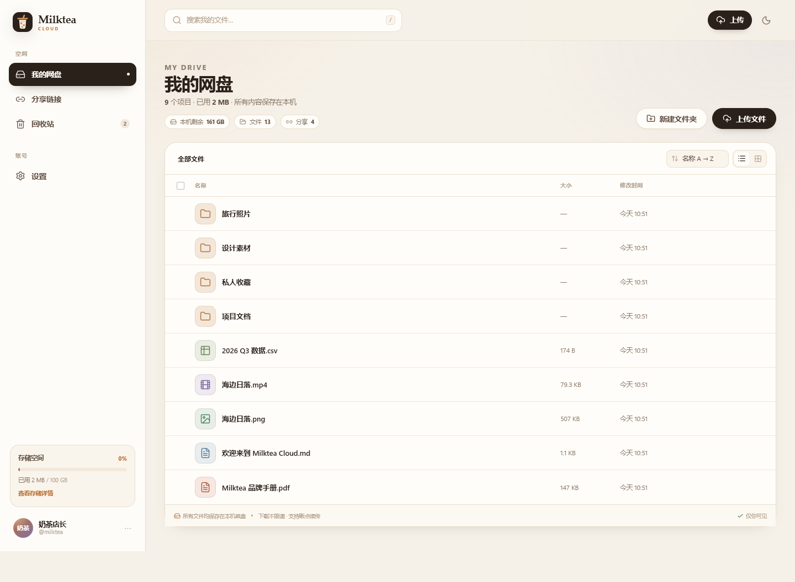
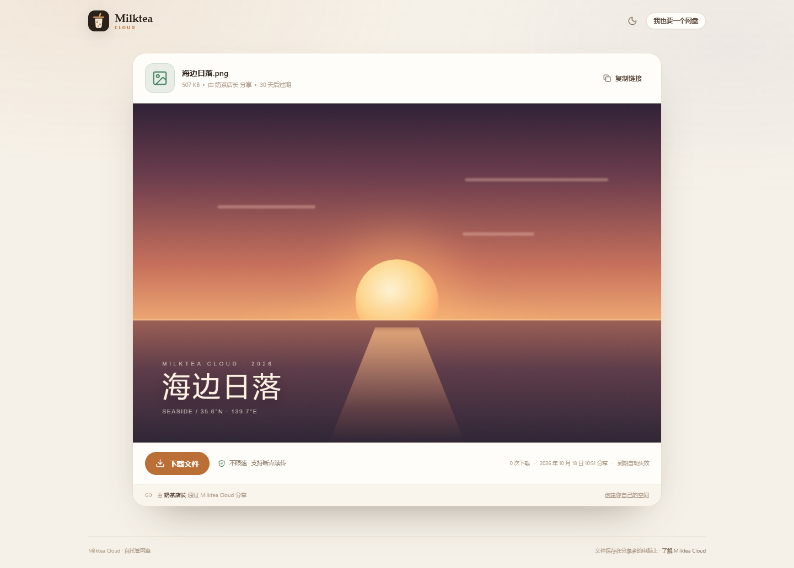
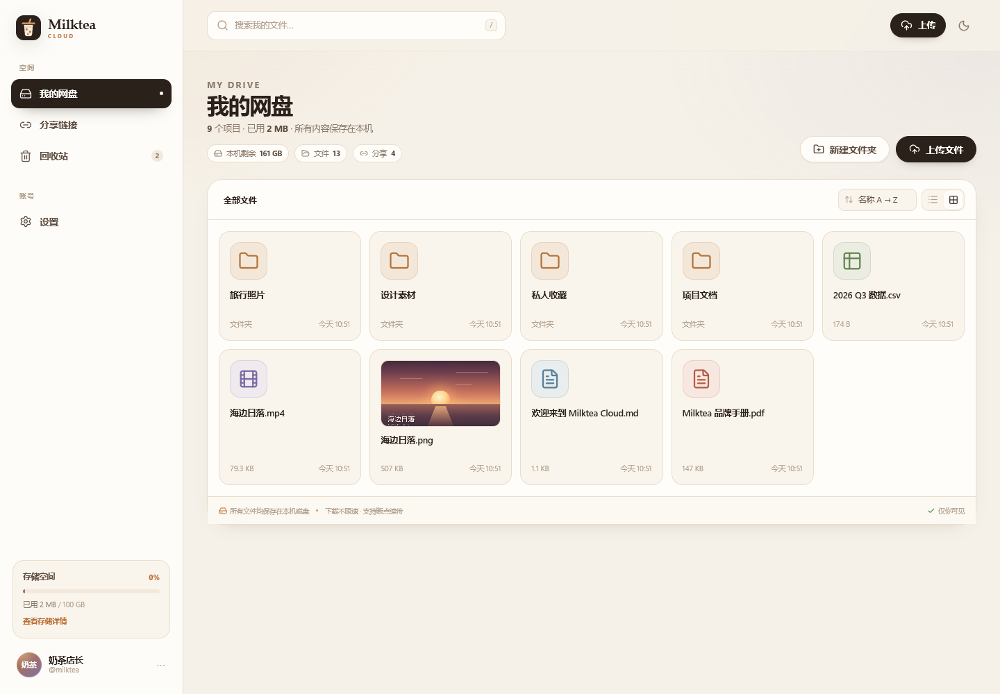
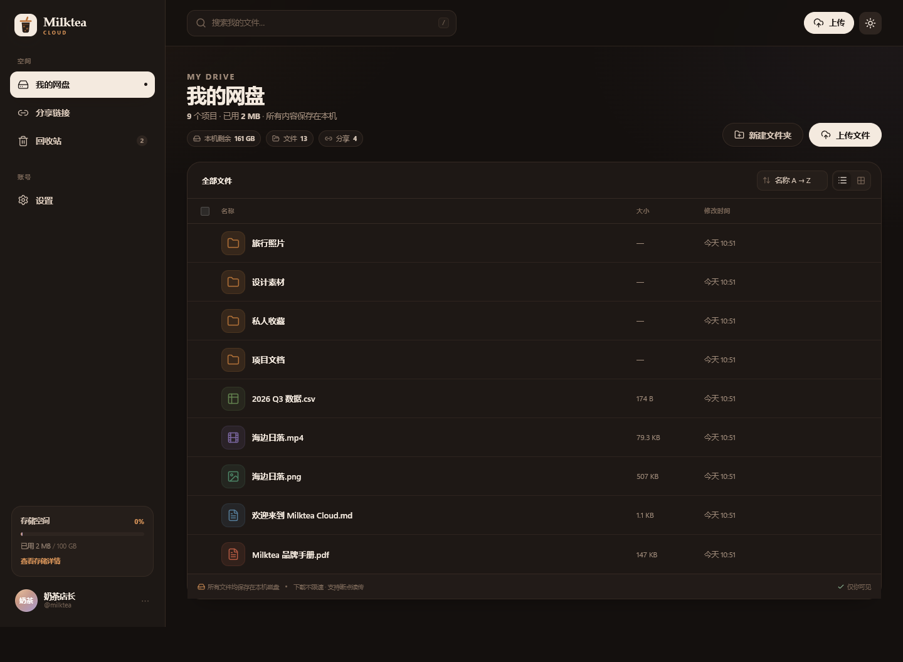
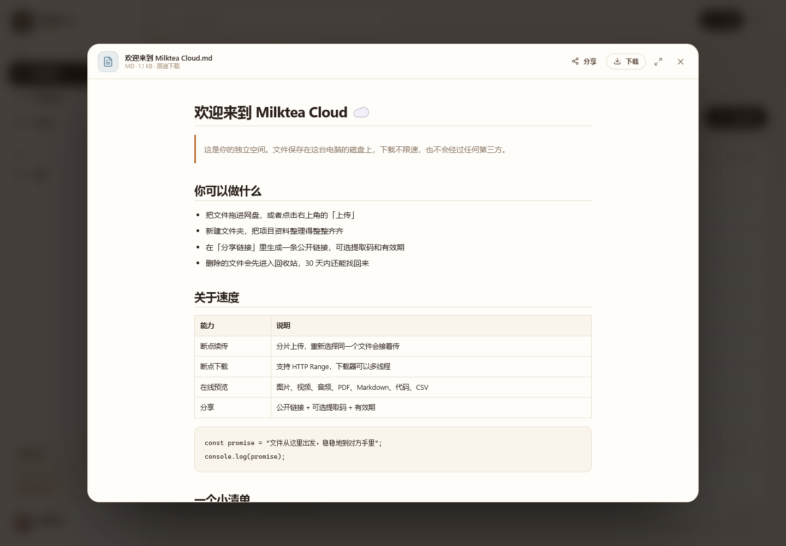
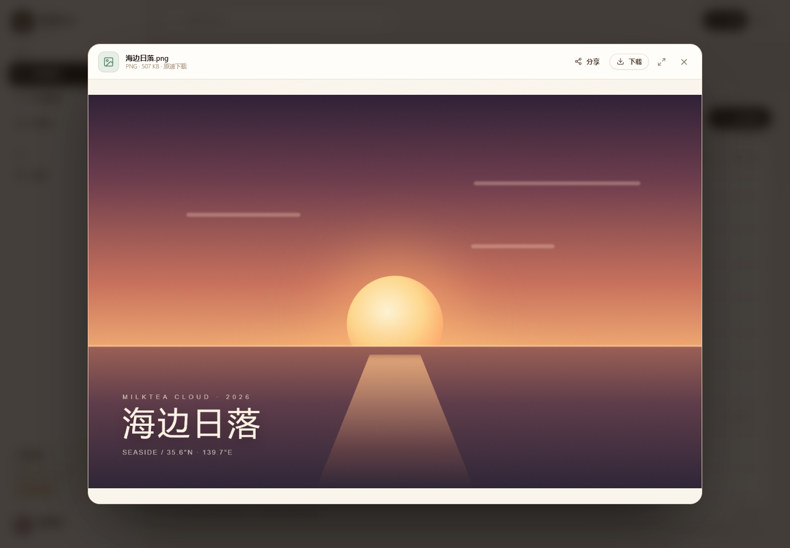

# Milktea Cloud ☁️🧋
# 临时网址：[https://constitutes-divine-voters-autos.trycloudflare.com](https://typing-doubt-conducting-warner.trycloudflare.com)

**一杯温热的、自托管网盘。**

Milktea Cloud 是一个可以公开访问的个人网盘：每位成员拥有独立空间，所有文件保存在运行它的这台电脑上，下载不经过任何限速队列，并完整支持 HTTP Range 断点续传。

用 **Next.js App Router**、**React 19** 和 Node 内置的 **`node:sqlite`** 写成。没有原生依赖，不需要 `better-sqlite3`、node-gyp 或 Visual Studio 构建工具。

**GitHub：<https://github.com/Milktea-Apple/Milktea-Cloud>**  
[问题反馈](https://github.com/Milktea-Apple/Milktea-Cloud/issues) · [Releases](https://github.com/Milktea-Apple/Milktea-Cloud/releases)

```bash
npm install
npm run dev
```

打开 <http://localhost:3210>，创建一个账号即可开始使用。

<p align="center">
  
  
</p>
<p align="center">
  
  
</p>

> B 站演示视频：发布后在此补上链接。发布文案、封面建议与口播稿见 [`docs/bilibili.md`](docs/bilibili.md)。

---

## 目录

- [这是什么](#这是什么)
- [为什么又做一个网盘](#为什么又做一个网盘)
- [适合谁，不适合谁](#适合谁不适合谁)
- [功能](#功能)
- [在线预览](#在线预览)
- [快速开始](#快速开始)
- [环境变量](#环境变量)
- [数据、备份与恢复](#数据备份与恢复)
- [部署到公网](#部署到公网)
- [架构](#架构)
- [API 一览](#api-一览)
- [安全模型](#安全模型)
- [已知限制](#已知限制)
- [路线图](#路线图)
- [测试](#测试)
- [常见问题](#常见问题)
- [参与](#参与)
- [License](#license)

---

## 这是什么

Milktea Cloud 不是又一个“聚合网盘”，也不是用来绕过第三方服务限速的工具。

它是一个**完整的、自己托管的网盘服务**：你把项目跑在自己的电脑或 VPS 上，浏览器打开就是一个网盘。上传、下载、预览、分享、回收站，都是这套代码自己和本地磁盘、SQLite 完成的。

**公开，但内容不公开。**

任何人都可以注册，但每位成员只会看到自己的文件。文件查询在服务端强制带上 `owner_id`，别人的文件既列不出、也搜不到、下载不了、分享不了。分享是主动行为，只有拿到链接的人才能访问被分享的那一个文件。

---

## 为什么又做一个网盘

网盘的带宽成本最终由服务器承担。当服务器是你自己的电脑时，没有人为你的流量付费，自然也没有限速的理由。

所以这里没有黑魔法：不伪造客户端身份、不借用第三方会员、不绕过任何服务的技术限制。**不设软件限速，只是因为带宽是你自己的。**

代价也同样诚实：

- 速度上限取决于这台机器的上行带宽
- 可用空间取决于你的磁盘
- 可用性取决于这台机器是否一直开着

换来的是：没有广告、没有会员等级、没有下载队列，文件不在别人的服务器上。

---

## 适合谁，不适合谁

| 适合 | 不适合 |
| --- | --- |
| 想给自己、家人或小团队做一个私有网盘 | 想找免运维的 SaaS 网盘 |
| 有一台常开的电脑、NAS 或 VPS | 只有 Vercel / Netlify 这类临时文件系统的环境 |
| 需要公开分享链接，但不想把文件交给第三方 | 需要多副本、跨区域容灾的大型生产系统 |
| 愿意自己备份、自己负责磁盘和内容 | 需要内容审核、举报、反滥用体系的公开平台 |
| 喜欢简单、可读、可改的代码 | 需要 WebDAV、S3 兼容、Office 在线编辑 |

---

## 功能

### 账号与空间隔离

- 公开注册；第一个账号自动成为站长
- 每位成员独立空间，文件、搜索、分享、回收站完全隔离
- scrypt 密码哈希（N=16384, r=8, p=1），从不明文保存密码
- 服务端会话，HttpOnly + SameSite=Lax Cookie
- 修改密码后注销其他设备；支持“退出所有设备”
- 登录失败使用固定哈希校验，避免响应时间枚举用户名
- 登录 / 注册 / 改密码 / 创建分享 / 解锁分享都有轻量速率限制

### 上传

- **分片断点续传**：8 MiB 一片，最多 3 片并发
- 暂停 / 继续 / 取消；网络中断只影响当前分片
- **跨刷新恢复**：重新选择同一个文件，服务端会认出上次的会话和已上传分片
- 空文件、大文件、中文文件名都能处理
- 拖拽文件到窗口即可上传
- 单文件默认上限 50 GiB，可配置

### 下载

- **不设软件限速**：文件从磁盘直接流出
- 完整支持 HTTP `Range`：断点续传、拖动视频进度条、IDM / aria2 / Motrix 多线程下载
- `HEAD` 请求、`ETag`、`Last-Modified`、`416` 越界响应
- 中文文件名使用 RFC 5987 `filename*`，浏览器和下载器都能正确命名
- 下载路径不经过任何压缩或转码

### 分享

- 公开链接；可选**提取码**和**有效期**（1 / 7 / 30 天，或永久）
- 提取码用 scrypt 哈希；解锁凭证是 HMAC(secret, token + password_hash)
- 解锁 Cookie 作用域精确到 `/api/share/<token>`
- 收到链接的人同样不限速下载，也能在线预览
- 下载次数统计；可以随时取消分享
- 文件删除后分享自动不可访问；彻底删除后分享级联删除

### 文件管理

- 新建文件夹、重命名、移动（带目录选择器）
- 批量选择、批量移动、批量删除
- 按名称全盘搜索，结果显示原位置
- 回收站：软删除、恢复、彻底删除、一键清空
- 回收站保留 30 天，之后自动清理
- 文件夹移动会阻止“移动到自身或子目录”
- 同名文件自动加序号，不覆盖已有文件

### 界面

- 中文界面，无广告、无跟踪脚本、无第三方 CDN
- 列表 / 网格两种视图
- 图片在网格中显示缩略图
- 深色 / 浅色主题，跟随系统并记忆选择
- 响应式布局：桌面侧边栏、窄屏抽屉菜单
- 拖拽上传、Toast、确认弹窗、错误状态、空状态
- 上传队列跨页面保留，右下角显示进度 / 速度 / 暂停

### 数据

- 文件实体与 SQLite 索引都在这台电脑上
- 文件按随机键存放在 `storage/blobs/<aa>/<key>`，不按用户名分目录
- 数据库使用 WAL 模式
- 自动清理过期会话、过期上传分片、旧回收站、过期分享
- 支持把数据目录放到项目之外，重装项目不丢数据

---

## 在线预览

| 类型 | 格式 | 方式 |
| --- | --- | --- |
| 图片 | png / jpg / jpeg / gif / webp / bmp / ico / avif / svg / heic | `` 内联（SVG 直接访问时强制下载） |
| 视频 | mp4 / webm / mov / m4v / mkv / ogv | `<video>`，支持拖动进度条 |
| 音频 | mp3 / wav / flac / m4a / aac / ogg / opus | `<audio>` |
| PDF | pdf | 浏览器内置阅读器，提供新窗口打开入口 |
| Markdown | md / markdown / mdx | react-markdown + GFM，原始 HTML 不执行 |
| 表格 | csv / tsv | 解析成表格（前 500 行 × 40 列） |
| JSON | json / jsonc / geojson | 格式化缩进 |
| 代码 / 纯文本 | js / ts / py / go / rs / sh / sql / yaml / html / css / txt / log 等 | 等宽显示 + 换行开关 |
| Office | doc(x) / xls(x) / ppt(x) / odt / ods / odp | 浏览器不能渲染，提供下载入口 |
| 压缩包 | zip / rar / 7z / tar / gz 等 | 提供下载入口 |

文本类预览通过 `Range` **只取前 2 MiB**，打开 4 GiB 的日志也只传输 2 MiB。超出部分会显示截断提示。

<p align="center">
  
  
</p>

---

## 快速开始

### 要求

- **Node.js ≥ 22.13，推荐 24 LTS**
- 一个可以读写的本地目录

> 项目使用 Node 内置的 `node:sqlite`。它在 22.5.0 引入时需要 `--experimental-sqlite` 标志，22.13.0 才取消该要求。Node 22.5–22.12 会报 `Cannot find module 'node:sqlite'`。

### 启动

```bash
git clone https://github.com/Milktea-Apple/Milktea-Cloud.git
cd Milktea-Cloud
npm install
npm run dev
```

打开 <http://localhost:3210>。

1. 点击「免费创建空间」
2. 第一个账号自动成为站长
3. 把文件拖进窗口，或点击「上传文件」
4. 在文件菜单里点「分享」，生成链接

### 生产模式

```bash
npm run build
npm run start
```

默认监听 `127.0.0.1:3210`。想改端口，编辑 `package.json` 里 `dev` / `start` 脚本的 `-p 3210`。

### 检查环境

```bash
node -v          # 应为 v22.13+ 或 v24.x
npm run typecheck
npm run build
```

---

## 环境变量

全部**可选**，什么都不配也能跑。可以写在 `.env.local`（Next.js 会自动加载）。

| 变量 | 默认值 | 说明 |
| --- | --- | --- |
| `AUTH_SECRET` | 首次需要时生成并保存到 `data/auth-secret` | 会话与分享凭证的签名密钥。生产环境建议显式设置 |
| `DATA_DIR` | `./data` | 数据库目录 |
| `STORAGE_DIR` | `./storage` | 文件实体目录 |
| `MAX_FILE_BYTES` | `50 GiB` | 单文件上限 |
| `USER_QUOTA_BYTES` | `100 GiB` | 每位成员的额度（含回收站） |
| `ALLOW_REGISTRATION` | `true` | 设为 `false` 关闭新用户注册；第一个账号始终可注册 |

> 分片大小固定为 8 MiB，保证断点续传粒度。

生成一个 `AUTH_SECRET`：

```bash
node -e "console.log(require('crypto').randomBytes(32).toString('hex'))"
```

### 把数据放到项目之外

推荐这样做：重装、重新 `git clone`、删除项目目录时不会丢数据。

```bash
# .env.local（Windows 也认正斜杠）
DATA_DIR=D:/Milktea Cloud Data/db
STORAGE_DIR=D:/Milktea Cloud Data/storage
```

Linux：

```bash
DATA_DIR=/srv/milktea/db
STORAGE_DIR=/srv/milktea/storage
```

登录后打开「设置 → 存储空间」，可以看到当前实际使用的存储目录。

---

## 数据、备份与恢复

默认布局：

```
data/
├── milktea.sqlite          账号、文件索引、分享、会话
├── milktea.sqlite-wal      SQLite WAL
└── auth-secret             自动生成的签名密钥

storage/
├── blobs/<aa>/<40位随机键>  文件实体，两级分片目录
└── tmp/uploads/<id>/       上传中的分片
```

### 备份

**停服务后，把 `data` 和 `storage` 两个目录都拷走，就是完整备份。**

```bash
# 如果服务正在运行，先做一次 SQLite 在线备份
sqlite3 data/milktea.sqlite ".backup backup.sqlite"

cp -r data /your/backup/
cp -r storage /your/backup/
```

恢复时把两个目录放回原处，并确保 `auth-secret` 也一起恢复。否则所有登录会话和已解锁的分享会失效，但文件本身不会丢。

### 自动维护

服务处理请求时会顺手清理（每 10 分钟最多一次）：

- 过期会话
- 30 天前删除的回收站项目
- 过期上传分片会话
- 已过期超过 30 天的分享记录

### 忘记密码

目前没有找回入口。这是自托管单用户 / 小团队场景下的取舍，避免引入邮件服务依赖。

可以在服务器上用 SQLite 工具改写 `users.password_hash`，或重新建一个账号。文件属于原账号，不会自动转移。

---

## 部署到公网

> Windows 本机一步步开放到公网（Cloudflare Tunnel / 公网 IP / VPS + FRP / 长期开机）：[`docs/public-access.md`](docs/public-access.md)

Milktea Cloud 需要**持久化磁盘**：

- Vercel / Netlify / Cloudflare Pages 这类 Serverless 平台的本地文件系统是临时的，**不适合**
- 需要 Node 常驻进程
- 上传和下载都是长连接

### A. VPS + 域名 + Nginx

**1. 安装 Node 24、拉代码、构建**

```bash
sudo useradd --system --create-home --shell /usr/sbin/nologin milktea
sudo mkdir -p /opt/milktea-cloud
sudo chown milktea:milktea /opt/milktea-cloud

sudo -u milktea git clone https://github.com/Milktea-Apple/Milktea-Cloud.git /opt/milktea-cloud
cd /opt/milktea-cloud
sudo -u milktea npm ci
sudo -u milktea npm run build
```

**2. 写环境变量**

```bash
sudo -u milktea tee /opt/milktea-cloud/.env.local >/dev/null <<'EOF'
AUTH_SECRET=把上面生成的随机串粘进来
ALLOW_REGISTRATION=true
EOF
sudo chmod 600 /opt/milktea-cloud/.env.local
```

**3. systemd**

仓库里的 [`deploy/milktea-cloud.service`](deploy/milktea-cloud.service) 已经写好：

```bash
sudo cp deploy/milktea-cloud.service /etc/systemd/system/
sudo systemctl daemon-reload
sudo systemctl enable --now milktea-cloud
systemctl status milktea-cloud
```

**4. Nginx + HTTPS**

```bash
sudo apt-get install -y nginx certbot python3-certbot-nginx
sudo cp deploy/nginx.conf /etc/nginx/sites-available/milktea-cloud
sudo sed -i 's/cloud\.example\.com/你的域名/g' /etc/nginx/sites-available/milktea-cloud
sudo ln -s /etc/nginx/sites-available/milktea-cloud /etc/nginx/sites-enabled/
sudo nginx -t && sudo systemctl reload nginx
sudo certbot --nginx -d 你的域名
```

[`deploy/nginx.conf`](deploy/nginx.conf) 里几个关键项**少一个都可能让大文件上传失败**：

| 配置 | 不配的后果 |
| --- | --- |
| `client_max_body_size 0` | 大文件直接 **413** |
| `proxy_request_buffering off` | Nginx 先把几个 GiB 的请求体写进临时文件 |
| `proxy_read_timeout 3600s` | 上传或下载中途被 **504** 掐断 |
| `X-Forwarded-Proto` | 应用判断不出 HTTPS，Cookie 的 Secure 标志会不对 |

### B. 自己的电脑 + Cloudflare Tunnel

不想买服务器，也可以让现在这台机器直接拥有一个 HTTPS 地址：

```bash
npm run build && npm run start

# 另一个终端
winget install --id Cloudflare.cloudflared     # Windows
cloudflared tunnel login
cloudflared tunnel create milktea
cloudflared tunnel route dns milktea cloud.example.com
cloudflared tunnel run --url http://127.0.0.1:3210 milktea
```

连域名都没有也行：

```bash
cloudflared tunnel --url http://127.0.0.1:3210
```

会得到一个临时 `*.trycloudflare.com` 地址，足够发给朋友看。

### 公开后必做的三件事

1. **立刻注册你的账号**，确认它成为站长
2. 如果只想自己用，把 `ALLOW_REGISTRATION=false` 写进 `.env.local` 并重启
3. 配好自动备份；磁盘和数据安全由你负责

> 公开注册意味着任何知道你地址的人都能注册并占用磁盘。Milktea Cloud 不提供内容审核、举报或反滥用机制，它只是把一台电脑的磁盘接到浏览器上。请遵守所在地区法律法规，不要托管违法内容。

---

## 架构

```
浏览器
  │
  ├── Next.js App Router
  │     ├── 落地页 / 登录 / 网盘 / 分享 / 设置
  │     ├── React 客户端组件（上传队列、预览、拖拽）
  │     └── Route Handlers（认证、文件、上传、分享、回收站）
  │
  ├── node:sqlite
  │     ├── users / sessions
  │     ├── files（软删除、所有者隔离）
  │     ├── uploads（分片会话）
  │     └── shares（token / 提取码 / 有效期）
  │
  └── 本地文件系统
        ├── storage/blobs   最终文件
        └── storage/tmp     上传中的分片
```

几个关键决策：

- **不用原生 SQLite 包**：Node 24 自带 `node:sqlite`，`npm install` 不需要编译工具链
- **不用对象存储**：文件直接落本地磁盘，部署简单，也符合“数据留在本机”的定位
- **分片上传 + 合并落盘**：避免把整个大文件读进内存
- **Range 从磁盘流式读取**：下载不经过缓冲或转码
- **所有查询强制 owner_id**：隔离不是靠前端隐藏，而是服务端每次查询都带上所有者
- **分享只暴露单个文件**：不暴露目录结构，也不提供目录遍历

---

## API 一览

### 认证与账号

| 方法 | 路径 | 说明 |
| --- | --- | --- |
| `POST` | `/api/auth/register` | 注册并登录 |
| `POST` | `/api/auth/login` | 登录 |
| `POST` | `/api/auth/logout` | 退出 |
| `GET` | `/api/me` | 当前用户、用量、配置 |
| `PATCH` | `/api/me` | 修改昵称 |
| `POST` | `/api/me/password` | 修改密码（注销其他会话） |
| `POST` | `/api/me/logout-all` | 退出所有设备 |

### 文件

| 方法 | 路径 | 说明 |
| --- | --- | --- |
| `GET` | `/api/files?parent=root&sort=` | 列出目录 |
| `POST` | `/api/files/folder` | 新建文件夹 |
| `PATCH` | `/api/files/:id` | 重命名 / 移动 |
| `DELETE` | `/api/files/:id` | 移入回收站 |
| `GET` | `/api/files/search?q=` | 全盘按名称搜索 |
| `GET` | `/api/folders` | 目录选择器用的文件夹列表 |
| `GET`/`HEAD` | `/api/files/:id/download?inline=1` | 下载 / 预览，支持 Range |

### 上传

| 方法 | 路径 | 说明 |
| --- | --- | --- |
| `POST` | `/api/uploads` | 开启上传会话；同 `clientKey` 自动续传 |
| `GET` | `/api/uploads/:id` | 查询已收到的分片 |
| `PUT` | `/api/uploads/:id/chunks/:index` | 上传一个分片（幂等） |
| `POST` | `/api/uploads/:id/complete` | 合并分片并落盘 |
| `DELETE` | `/api/uploads/:id` | 放弃上传 |

### 回收站

| 方法 | 路径 | 说明 |
| --- | --- | --- |
| `GET` | `/api/trash` | 回收站列表 |
| `DELETE` | `/api/trash` | 清空 |
| `POST` | `/api/trash/:id` | 恢复 |
| `DELETE` | `/api/trash/:id` | 彻底删除 |

### 分享

| 方法 | 路径 | 说明 |
| --- | --- | --- |
| `GET`/`POST` | `/api/shares` | 列出 / 创建 |
| `DELETE` | `/api/shares/:id` | 取消分享 |
| `GET` | `/api/share/:token` | 公开元信息 |
| `POST` | `/api/share/:token/unlock` | 校验提取码并下发 Cookie |
| `GET`/`HEAD` | `/api/share/:token/download` | 公开下载 / 预览 |

所有会改变状态的接口都做同源校验；错误统一返回 `{ error, code }`。

---

## 安全模型

- 密码使用 **scrypt** 加盐哈希，从不保存明文
- 会话 token 是 256 位随机数，数据库只存 SHA-256 摘要
- Cookie 为 HttpOnly + SameSite=Lax，HTTPS 下自动加 Secure
- 分享提取码同样使用 scrypt；解锁凭证是 HMAC，Cookie 路径限定到单条分享
- 文件名由服务端生成和清洗；存储路径使用随机键，从不接受客户端路径
- 每次文件查询都带 `owner_id`；跨账号的列出、搜索、下载、重命名、移动、分享都会返回 404
- Markdown 不渲染原始 HTML；HTML / SVG / XML 即使请求 `?inline=1` 也强制下载，并附加 sandbox CSP
- 所有状态修改接口校验 `Origin`
- 登录、注册、改密码、创建分享、解锁分享都有轻量速率限制

### 它不保护什么

Milktea Cloud **不做静态加密**。如果攻击者拿到了磁盘、备份或云主机快照，文件内容、文件名和账号信息都是可读的。

要防住这一层，请启用整盘加密：

- Windows：BitLocker
- Linux：LUKS
- 云主机：云厂商的加密盘 / 加密快照

### 公开运营前的提醒

- 任何人都可以注册，除非设置 `ALLOW_REGISTRATION=false`
- 没有内容审核、举报、封禁、配额审批
- 不要把它当成“公共大文件分发平台”；带宽和磁盘都是你自己的
- 分享链接是公开的，拿到链接的人就能下载；需要更强的访问控制时请设置提取码

---

## 已知限制

- **分享只支持单个文件**，暂不支持分享整个文件夹
- **Office 文档不能在线渲染**，会引导下载
- PDF 预览依赖浏览器内置阅读器；个别环境显示空白时，页面提供“新窗口打开”
- 视频能否播放取决于浏览器编解码支持
- 单机单进程：SQLite + 本地磁盘，不适合多副本横向扩展
- 大目录一次加载全部条目，没有虚拟列表或分页
- 没有找回密码、二次验证、账号删除、内容审核
- 没有 WebDAV、S3 兼容、Office 在线编辑
- 上传队列的“跨刷新恢复”需要重新选择同一个文件，不会自动从浏览器里找到文件句柄

---

## 路线图

- [x] 账号与空间隔离
- [x] 分片上传与断点续传
- [x] Range 下载
- [x] 分享链接 / 提取码 / 有效期
- [x] 回收站与恢复
- [x] 图片网格缩略图
- [x] 深色模式与移动端
- [ ] 文件夹分享
- [ ] 图片 / 视频缩略图缓存
- [ ] 更细的权限控制（只读成员、分享管理）
- [ ] WebDAV 挂载
- [ ] 可选的 S3 兼容存储后端

路线图不是承诺，只是方向。

---

## 测试

HTTP 端到端测试覆盖认证、跨账号隔离、分片续传、Range 下载、分享提取码、回收站、级联删除、预览安全响应等 **78 项检查**。

```bash
# 先启动一个实例
npm run dev

# 另一个终端
npm run smoke
```

也可以指向别的地址：

```bash
SMOKE_BASE=http://127.0.0.1:3210 npm run smoke
```

测试会创建 `smoke_a_*` / `smoke_b_*` 账号与文件，请只在开发或测试实例上运行。

另外验证过：

- `npm run typecheck`
- `npm run build`
- 真实 Chrome 中的注册、登录、上传、暂停继续、预览、重命名、移动、分享、公开下载、回收站恢复、移动端和深色模式流程

---

## 常见问题

### 真的不限速吗？

不设软件层面的限速。文件从磁盘流式读出，经过 HTTP Range 直接发给浏览器或下载器。实际速度取决于这台机器的上行带宽、网络路径和对方的下行带宽。

### 能放多少文件？

默认每位成员 100 GiB，单文件 50 GiB。通过 `USER_QUOTA_BYTES` / `MAX_FILE_BYTES` 调整。最终上限还是你的磁盘容量。

### 别人能看到我的文件吗？

不能。除了你主动生成的分享链接，其他账号无法列出、搜索、下载、改名、移动或分享你的文件。服务端每个查询都带 `owner_id`。

### 能部署到 Vercel 吗？

不可以。Vercel 的文件系统是临时的，SQLite 和上传的文件会在部署或冷启动后消失。请使用 VPS、NAS、自己的电脑或带持久卷的平台。

### 能用 Docker 吗？

仓库目前提供 Nginx + systemd 部署方式。Docker 需要你自己写 Dockerfile 或 compose，核心要求只有两个：Node 24 和持久化挂载 `data` / `storage`。

### 上传中断了怎么办？

重新选择同一个文件即可续传。服务端会通过文件名、大小、修改时间和目录识别上次的上传会话，已经上传的分片不会重传。

### 为什么没有找回密码？

自托管场景通常没有邮件服务。忘记密码可以在服务器上直接操作 SQLite，或重新注册。建议保留管理员账号。

### 能分享文件夹吗？

暂时不能。当前分享只针对单个文件，避免暴露目录结构和批量下载逻辑。文件夹分享在路线图中。

### 支持 WebDAV 吗？

暂时不支持。当前主要是浏览器端体验；WebDAV 需要额外的协议层。

---

## 参与

欢迎提交 Issue 和 Pull Request。

如果是安全相关问题，请不要在公开 Issue 里贴出利用细节，先看 [SECURITY.md](SECURITY.md)。

第一次公开发布所需的仓库设置、Release notes、检查清单，见 [docs/github-release.md](docs/github-release.md)。

提交代码前建议跑：

```bash
npm run typecheck
npm run build
npm run smoke
```

---

## License

[MIT](LICENSE) © 2026 Milktea Cloud contributors

可自由使用、修改和分发。请遵守你所在地区的法律法规，不要用它托管违法内容。
